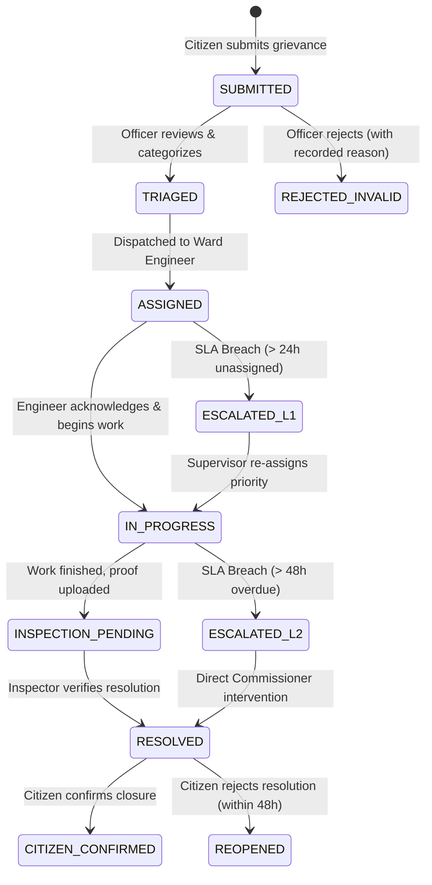

# 🏛️ GovFix — Configurable Public-Institution Workflow Engine
### Track: Municipal Grievance Resolution & Accountability Engine (PCMC / PMC Pune)
**VORTEXA 3.0 Hackathon · Problem Statement: G-02 (Domain 7: Government Systems & GovTech)**

---

## 📌 Executive Summary
Public grievance systems in municipalities often fail not because complaints aren't registered, but because **workflows stall in unmonitored limbo, deadlines pass silently, and no tamper-proof record exists of who changed a status or ignored an escalation.**

**GovFix** is an institutional-grade, finite-state workflow engine designed for municipal administrations. It enforces:
1. **Deterministic State Machine**: Strict role-based transitions that cryptographically refuse illegal state jumps or unauthorized moves.
2. **Dynamic SLA & Multi-Tier Escalation Engine**: Real-time clocks per grievance category with automated supervisor escalation upon breach.
3. **Tamper-Evident Audit History**: Every accepted transition, refused attempt, role verification, and escalation is signed and immutably logged.
4. **Sidecar AI Intelligence (FreeLLMAPI)**: Multilingual Marathi/Hindi/English extraction, duplicate detection, and draft response generation that *informs* officers without silently overriding statutory authority.

---

## 🗺️ System Architecture

```mermaid
flowchart TD
    subgraph Citizens & Field Staff
        C[Citizen: File / Track / Verify]
        O[Field Officer: Triage / Work / Resolve]
        S[Supervisor / Commissioner: Oversee / Escalate]
    end

    subgraph GovFix Engine [OrbitX_Vortexa3.0]
        API[Gateway & Role Verifier]
        FSM[Deterministic FSM Guard Engine]
        SLA[SLA Clock & Auto-Escalation Daemon]
        AUDIT[Tamper-Evident Cryptographic Ledger]
    end

    subgraph AI Sidecar [FreeLLMAPI Router]
        LLM[Multi-Model Inference: 1min.ai / Groq / Gemini]
        EXTRACT[Multilingual Extraction: Category, Urgency, Ward]
        DEDUP[Duplicate & Proximity Anomaly Detection]
        DRAFT[Official Action Note & Citizen Update Drafter]
    end

    C & O & S -->|Role-Guarded Requests| API
    API -->|Validate Permitted Transitions| FSM
    FSM -- Illegal Transition -->|REJECT + Log Refusal Code| AUDIT
    FSM -- Valid Transition -->|Accept + State Change| AUDIT
    FSM <--> SLA
    SLA -- Breach Detected -->|Auto-Escalate to Supervisor| FSM
    
    API -.->|Async Non-Blocking Analysis| LLM
    LLM --> EXTRACT & DEDUP & DRAFT
    EXTRACT & DRAFT -.->|Non-Binding Recommendations| O
```

---

## 🔄 Finite State Machine (FSM) Lifecycle



### State Transition & Role Matrix

| Current State | Target State | Permitted Roles | Prerequisite Checks |
| :--- | :--- | :--- | :--- |
| `[*] (None)` | `SUBMITTED` | `CITIZEN` | Valid location, description, citizen contact |
| `SUBMITTED` | `TRIAGED` | `OFFICER`, `SUPERVISOR` | Category, Ward & Priority verified |
| `SUBMITTED` | `REJECTED_INVALID` | `OFFICER`, `SUPERVISOR` | Mandatory justification logged |
| `TRIAGED` | `ASSIGNED` | `OFFICER`, `SUPERVISOR` | Target Field Engineer ID attached |
| `ASSIGNED` | `IN_PROGRESS` | `FIELD_ENGINEER` | Engineer acknowledges work order |
| `IN_PROGRESS` | `INSPECTION_PENDING` | `FIELD_ENGINEER` | Resolution notes & photo/evidence link attached |
| `INSPECTION_PENDING` | `RESOLVED` | `OFFICER`, `SUPERVISOR` | On-site inspection sign-off |
| `RESOLVED` | `CITIZEN_CONFIRMED` | `CITIZEN` | Citizen satisfaction score (1-5) |
| `RESOLVED` | `REOPENED` | `CITIZEN` | Feedback note within 48h window |
| *Any Active* | `ESCALATED_L1/L2` | `SYSTEM_SLA_DAEMON`, `SUPERVISOR` | Timestamp exceeds category deadline |

#### 🛡️ Explicit Refusal Rules (Zero Silently Ignored Moves)
- **Code `ERR_ROLE_UNAUTHORIZED`**: E.g., Citizen attempts to change status to `RESOLVED` or Officer attempts to bypass `CITIZEN_CONFIRMED`.
- **Code `ERR_ILLEGAL_STATE_JUMP`**: E.g., Jumping from `SUBMITTED` directly to `RESOLVED` without triage/assignment.
- **Code `ERR_MISSING_EVIDENCE`**: Attempting `INSPECTION_PENDING` without attaching work completion notes.
- **Every refusal is immutably recorded** in the ticket's audit trail with timestamp, user ID, attempted state, and refusal reason.

---

## ⏱️ Dynamic SLA & Auto-Escalation Timelines

| Category | Typical Pune Grievance | Target SLA | Tier-1 Escalation (Ward Officer) | Tier-2 Escalation (Municipal Commissioner) |
| :--- | :--- | :--- | :--- | :--- |
| **Emergency / Hazard** | Open electrical cable, sewer main burst | **12 Hours** | After 6 Hours | After 12 Hours |
| **High Priority** | Arterial road pothole, contaminated water | **24 Hours** | After 12 Hours | After 24 Hours |
| **Standard** | Streetlight malfunction, stray animal nuisance | **48 Hours** | After 36 Hours | After 48 Hours |
| **Routine / Administrative** | Garbage collection delay, tree trimming | **72 Hours** | After 48 Hours | After 72 Hours |

*Includes an interactive **Judge Time-Travel Panel** to advance simulated time by 12h/24h/48h to demonstrate live auto-escalations during testing.*

---

## 🤖 Role of AI (FreeLLMAPI Non-Binding Copilot)

In strict compliance with hackathon correctness rules (*"AI may inform decisions but must not silently override them"*):
1. **Multilingual Grievance Extraction**: Accepts raw Marathi, Hindi, or conversational English text and proposes `{ category, urgency, ward, extracted_entities }`.
2. **Duplicate & Cluster Detection**: Flags complaints from the same street/ward within 24 hours to prevent redundant work orders.
3. **Official Action Drafter**: Proposes pre-formatted administrative responses and citizen notifications in Marathi/English for officer approval.
4. **Transparent Badging**: All AI suggestions are badged as *"Draft - Requires Officer Confirmation"* and cannot mutate ticket status.

---

## 📂 Implementation Roadmap (12-Hour Timeline)

- [x] **Hour 1**: Problem statement selection, workflow architecture, state machine definition, repository bootstrapping.
- [ ] **Hours 2–4**: Core FSM engine, role guard middleware, SLA calculation daemon, and tamper-evident audit logger.
- [ ] **Hours 5–7**: FreeLLMAPI AI sidecar integration (multilingual extraction, duplicate cluster analysis, drafting).
- [ ] **Hours 8–10**: Interactive Web Dashboard (Citizen View, Officer Queue, Commissioner War Room, and Judge Time-Travel Simulator).
- [ ] **Hours 11–12**: End-to-end integration tests, edge case verification (refusals, out-of-order attempts), final presentation polish.
